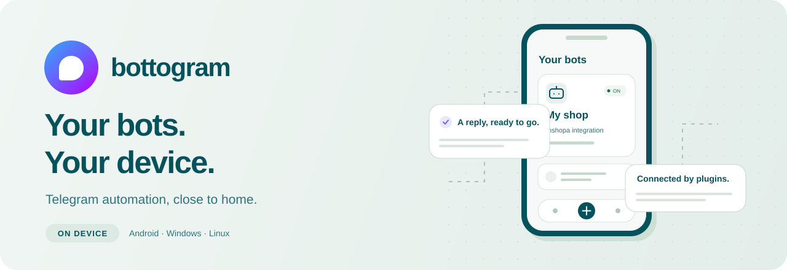

<div align="center">



**Build a Telegram bot. Keep it on your device.**

Create replies, install integrations, and answer conversations from one app.

[](https://github.com/hayyaun/bottogram/actions/workflows/build.yml)


[Try a build](#try-a-build) · [Get started](#get-started) · [Plugins](#plugins) · [Development](#development) · [Roadmap](docs/REMAINING_WORK.md)

</div>

---

Bottogram is a Flutter app that runs Telegram bots locally. Configure a bot by
hand or choose an installed plugin, start it, and let your device handle Telegram
updates and API requests. Bot execution does not need a separate Bottogram server.
Your device still needs a network connection to Telegram and any connected service.

> **Work in progress.** Test builds are available through GitHub Actions once a
> successful build completes. Public releases are deferred while the Inshopa
> integration and real-device verification develop. See the [current roadmap](docs/REMAINING_WORK.md).

## What you can do

- **Build without writing code.** Configure command, text, callback and inline-query
  events, replies, dice actions, and reusable reply/inline keyboards.
- **Install integrations.** Import a declarative JSON plugin and fill in its
  generated setup form. Plugin versions stay pinned to the bots that use them.
- **Answer from the inbox.** Open a bot's users, read retained conversations,
  reply manually, and open attachments on demand.
- **Keep started bots running on Android.** A foreground service, ongoing Stop
  notification, and battery-settings guide support execution while the UI is away.
- **Use your desktop too.** Windows and Linux builds run bots while the application
  remains running. They share the same configuration and plugin concepts.

## Try a build

Open [GitHub Actions](https://github.com/hayyaun/bottogram/actions/workflows/build.yml),
choose a successful run, and download its artifact. GitHub may ask you to sign in.

- **Android:** `bottogram-android-release` — a universal, optimized release-mode APK.
- **Windows x64:** `bottogram-windows-x64` — extract the complete ZIP and run
  `bottogram.exe` alongside its DLLs and data.
- **Linux x86_64:** `bottogram-linux-x86_64` — extract the AppImage tarball and run
  the included executable. A desktop keyring is needed for plugin API keys.

These are testing artifacts, retained for 14 days, without store publishing or
GitHub Releases. Android uses release build mode with the project's current
development signing certificate; production signing is not configured. Updating
between CI runs may require a different installation. See [build details and platform requirements](docs/BUILD_ARTIFACTS.md).

## Get started

1. Create a Telegram bot with [@BotFather](https://t.me/BotFather) and keep its token private.
2. In Bottogram, choose **Create bot** — the centered **+** on mobile.
3. Enter a name, the bot token, and your numeric Telegram admin ID. Choose
   **Manual** or a plugin; its additional fields appear in the same form.
4. Open your bot in Telegram and send `/start`, so it can message your account.
5. Start the bot in Bottogram. On Android, follow **Keep bots running** to check
   battery/background and notification settings.

Tap a bot card to open its **users and inbox**. The card's **Settings** gear opens
configuration. Plugin setup values have a separate **Edit parameters** page;
leaving a saved API key blank keeps its current value.

## Plugins

Plugins are `.bottogram-plugin.json` files containing validated configuration,
fields, and automations. The host executes registered **triggers → actions**;
packages do not download or execute arbitrary Dart code. Adding a new host
capability requires an application update.

To install an additional package, open **Plugins → Install from file** and review
its declared API destinations and capabilities before installing it.

### First integration: Inshopa

The bundled **Inshopa 0.5.0** plugin connects one shop using its API key and
registered storefront URL. A separate shop ID is not required.

- `/products` and `/products 2` show catalog pages to any Telegram user.
- Paid-order polling sends alerts only to the configured admin.
- The first complete scan establishes a baseline without historical alerts.
- Purchase alerts can be disabled in that bot's plugin preferences.

The key needs `storefront:read` for products and `shop:orders:read` for order
alerts. Purchases currently happen on the shop website, not inside Telegram.

**Verification so far:** the local catalog command and admin connection message
were confirmed end to end. A newly paid order alert, production-key access, and
physical-device delivery remain unverified. Current-state order polling is
best effort; it is not a durable payment event feed.

See [plugin architecture and recovery behavior](docs/PLUGIN_RUNTIME.md),
[example packages](examples/plugins), and the [remaining integration work](docs/REMAINING_WORK.md).

## Runtime and local data

- Bots run on your device. Android/OEM termination and network outages can
  interrupt them; battery exemption does not guarantee delivery.
- After Android force-stop, process death, or reboot, reopen Bottogram and start
  the bots again. Saved automation progress remains available.
- Plugin API keys use platform secure storage. Bot tokens are part of local bot
  configuration; treat application data and configuration exports as private.
- The inbox keeps up to 20 messages per conversation and has a configurable
  cache limit. Clearing or evicting messages removes their local content.
- Manual bot definitions support configuration sharing. Plugin-bot exports are
  not implemented. Credentials and conversation histories are not plugin packages.

## Development

The current build toolchain uses **Flutter 3.29.1**, **Dart 3.7**, and **JDK 17**.
Android requires **API 23+**; native build tools are needed for desktop targets.

```sh
git clone https://github.com/hayyaun/bottogram.git
cd bottogram
flutter pub get --enforce-lockfile
flutter analyze --no-pub
flutter test --no-pub
```

Choose a configured target, then run `flutter run -d <device-id>`. For native
SDK requirements and test packaging, see [Build artifacts](docs/BUILD_ARTIFACTS.md).
Live Inshopa and Android background integration tests are separate, opt-in checks;
ordinary CI does not require real Telegram tokens or shop keys.

The project uses Cubit for UI state, Hive for local persistence, Televerse for
Telegram, and a host-side automation registry for plugins.

## Contributing

Issues and focused pull requests are welcome. Describe the problem, platform,
steps to reproduce, and expected behavior. Discuss larger plugin capabilities
before implementing them so they fit the host's declarative architecture.

Never include bot tokens, API keys, private exports, or customer data in an issue,
pull request, screenshot, or build log.

Start with the [roadmap](docs/REMAINING_WORK.md) and [runtime documentation](docs/PLUGIN_RUNTIME.md).
