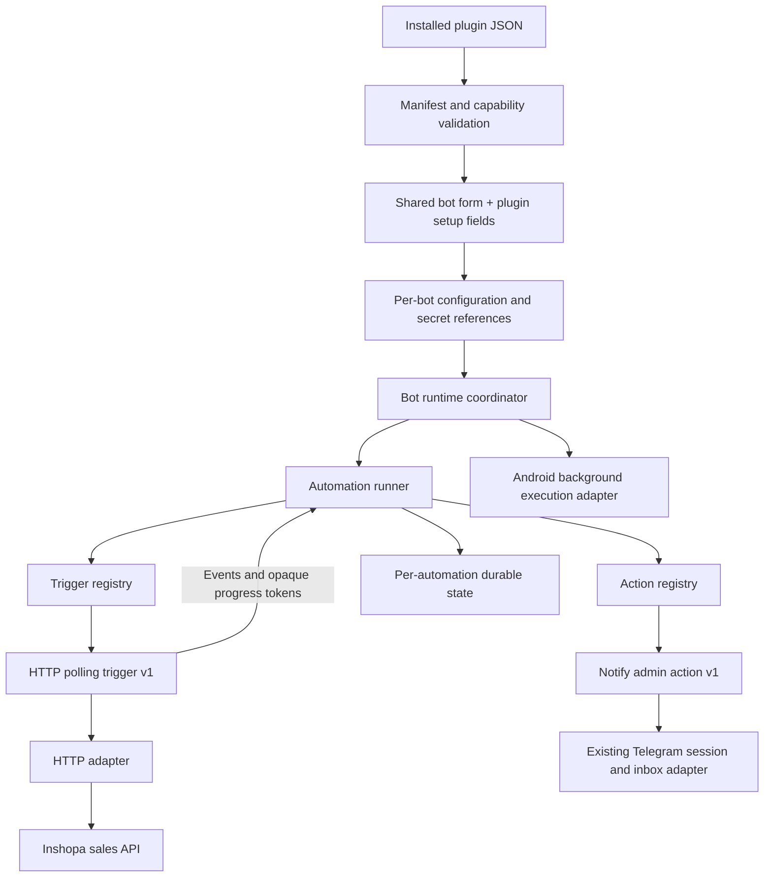

# Plugin automation contract proposal

Implementation update: the automation structure was approved. [Plugin runtime](PLUGIN_RUNTIME.md) documents the implemented component registry, recovery semantics, product command, Android runtime and order polling. Inshopa adopted its existing scoped summary list rather than the dedicated cursor-based feed proposed below. Version 0.5.0 uses `http.poll-list.v1` and persistent per-order receipts. Placeholder sales URLs below are historical illustrations, not executable requests.

Status: proposal for review, not an installed or runnable plugin. The current Inshopa 0.2.0 asset is unchanged and remains setup only.

## Model and naming

A plugin is a versioned package containing metadata, setup fields, settings, and automations.

An **automation** connects one **trigger** to an ordered list of **actions**:

- A trigger determines when an event becomes available. For Inshopa, HTTP polling discovers a new successful order.
- An action handles that event. For Inshopa, the first action sends a notification to the configured admin.
- The automation runner owns sequencing, progress, and cancellation between them.

This replaces the earlier `behaviors` proposal for a structural reason: that name combined an event source and its effects in one broad abstraction. `automations → trigger + actions` states the execution model directly. It also fits the existing manual event/action model, which can later be adapted to Telegram triggers without changing its stored Hive fields.

The first implementation still contains only one HTTP polling trigger and one Telegram notification action. These interfaces do not imply an arbitrary workflow graph, scripting language, a complete HTTP API SDK, or unimplemented trigger types.

## Boundaries



- **Catalog/parser:** installs immutable package versions, generates fields, and validates every automation against its selected trigger and action schemas. Unknown types/versions, duplicate IDs, invalid references, and unsupported capabilities fail installation explicitly.
- **Bot runtime coordinator:** owns Start/Stop/Delete, one session per bot, aggregate status, and an execution-host lease. It creates automation runners without interpreting HTTP configuration or branching on the plugin's Inshopa ID.
- **Automation runner:** owns one trigger and its ordered actions. It records pending events and action acknowledgments, then advances durable progress only after the event's required actions are handled.
- **Trigger registry:** resolves an identifier such as `http.poll.v1` to a host factory and its schema. The HTTP polling trigger schedules reads, validates/projects responses, and emits events. It does not independently commit progress before actions complete.
- **Action registry:** initially provides `telegram.notify-admin.v1`. This action resolves the shared admin ID and uses the existing Telegram client/inbox path. It does not receive an arbitrary recipient or raw bot token from plugin configuration.
- **Ports/adapters:** supply HTTP, Telegram, secret access, durable state, and Android execution through narrow interfaces. The core has no widget, BuildContext, Android settings, or method-channel dependency.

An event has a stable normalized `id` and its declared payload. Message templates read event data and allowed nonsecret settings. Authentication secret references are resolved separately and never enter template context.

The Android service keeps the runtime alive and provides user-visible controls. It contains no Inshopa or polling logic. The proposed cached Flutter engine keeps UI and runtime in one Dart isolate with one Hive owner. Multiple automations share the same bot session and never introduce competing Telegram update consumers.

## Proposed Inshopa JSON

This is the proposed manifest-v2 shape. The current v1 installer does not accept it yet. Version 0.3.0 and the live status describe the intended future package, not a published or activated integration.

```json
{
  "manifestVersion": 2,
  "hostApiMajor": 2,
  "id": "bottogram-plugin-inshopa",
  "name": "Inshopa",
  "version": "0.3.0",
  "executionStatus": "live",
  "requiresBotFields": [
    "adminTelegramUserId"
  ],
  "setupFields": [
    {
      "key": "apiKey",
      "label": "Inshopa API key",
      "type": "secret",
      "required": true
    }
  ],
  "settings": [
    {
      "key": "notifyNewSuccessfulPurchases",
      "label": "آگاه شدن از آخرین خرید های موفق",
      "type": "boolean",
      "default": true
    }
  ],
  "automations": [
    {
      "id": "new-successful-orders",
      "enabledBySetting": "notifyNewSuccessfulPurchases",
      "trigger": {
        "type": "http.poll.v1",
        "config": {
          "intervalSeconds": 60,
          "request": {
            "method": "GET",
            "url": "<CONFIRMED_INSHOPA_SALES_API_URL>",
            "authentication": {
              "type": "bearer",
              "secretField": "apiKey"
            }
          },
          "response": {
            "itemsPath": "orders",
            "itemIdPath": "id",
            "checkpointPath": "checkpoint"
          },
          "pagination": {
            "cursorQueryParameter": "cursor",
            "nextPagePath": "next_cursor",
            "hasMorePath": "has_more"
          }
        }
      },
      "actions": [
        {
          "id": "notify-admin",
          "type": "telegram.notify-admin.v1",
          "config": {
            "text": "New successful order: {{event.id}}"
          }
        }
      ]
    }
  ]
}
```

The URL and response paths are illustrative until the successful-sales contract is confirmed. No endpoint or response field is claimed to exist by this example. Page continuation and a durable checkpoint are separate concepts; if the API deliberately uses one token for both roles, its actual contract will determine the simpler mapping. The 60-second interval is a proposal to check against rate limits. Initial synchronization still needs a confirmed delivery policy before activation.

The JavaScript SDK's existing transport sends `Authorization: Bearer ...`, `X-Storefront-Host`, `Origin`, and `Accept` to `/v1` paths. This is a request reference, not a requirement to port that SDK. Any required host/origin context for the eventual sales call must come from its actual contract. Creation inputs stay as agreed: common bot name/token/admin ID, plus only the Inshopa API key.

## State, safety, and compatibility

- Each automation and action has a unique, stable ID within its parent. State is isolated by bot instance, pinned package/source identity, automation ID, event ID, and action ID as applicable.
- Persist action acknowledgments independently so a confirmed completed action need not repeat merely because a later action fails. Crashes and ambiguous Telegram responses still prevent an exactly-once delivery guarantee.
- Keep requests non-overlapping within a polling trigger. Long-running I/O from one bot must not hold a global storage or lifecycle queue for other bots.
- Secret values cannot appear in templates, query strings, logs, or exported configuration. Authentication resolves a secret reference only for the declared sink on the approved HTTPS origin; redirects do not forward credentials.
- Stop/Delete prohibit new requests and sends. Pending work and already received acknowledgments follow the host's cancellation/progress rules, not arbitrary plugin flags.
- Keep v1 setup-only packages and pinned bindings readable with their existing meaning. Do not silently activate an existing bot or overwrite installed package bytes. Any data migration or binding conversion needs a separately scoped proposal and approval.

## Extension rule

A new plugin that uses supported triggers/actions needs only JSON. A new trigger or action type requires one host implementation, schema, registration, and tests, after which multiple plugins can use it.

For example, a future Telegram-command trigger could be added to another automation in the same plugin and share its existing Telegram session. An unsupported type remains an installation error until the host supplies it.

Logical ownership can be introduced without wholesale file moves:

```text
lib/plugins/             manifest, catalog/bindings, generated forms
lib/runtime/             coordinator, automation runner, ports and registries
lib/runtime/triggers/    HTTP polling trigger
lib/runtime/actions/     notify-admin action
lib/background/          Android adapter and battery guide
lib/inbox/               existing capture and conversation services
```

The current background foundation is unfinished and will be aligned with these boundaries before integration. This document does not claim Android background execution, a v2 parser, a polling trigger, or a real Inshopa connection has been implemented or device-verified.
