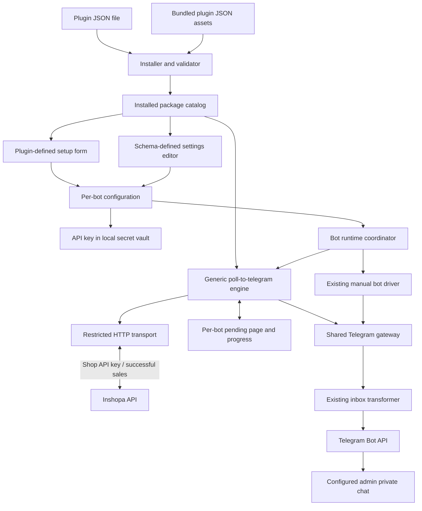
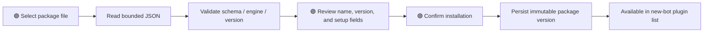
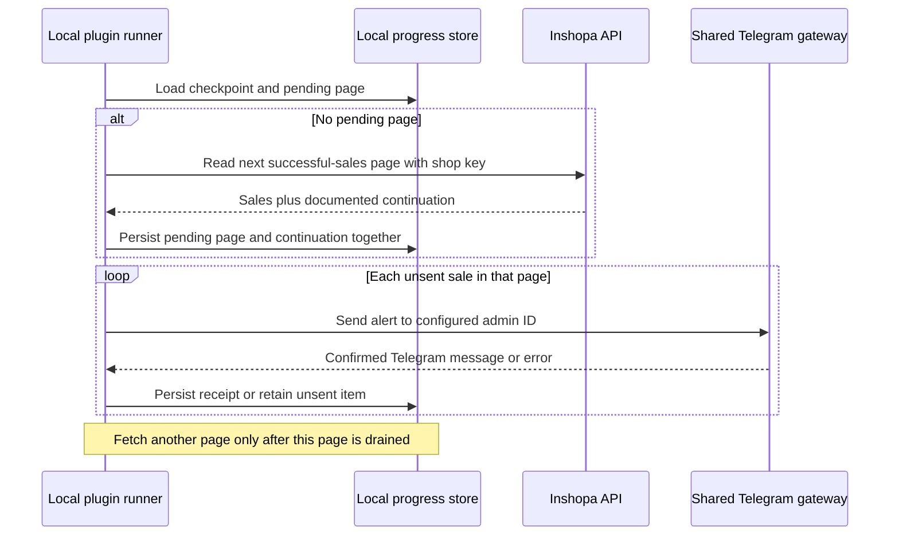

# Plugin installation and Inshopa plugin: implementation proposal

Current implementation: [Plugin runtime](PLUGIN_RUNTIME.md) supersedes the setup-only implementation slice below. The approved `automations → trigger → actions` runtime, Android foreground execution, battery guide, public `/products` command and private admin alerts are implemented. Version 0.5.0 uses the existing scoped order-summary list with client-side paid filtering and persistent delivery receipts. The Inshopa permission is activated locally; production rollout is separate. Existing installed versions and bindings remain pinned.

Date: 2026-11-09 (Asia/Tehran). The user approved JSON file installation, a shared creation form, bundled Inshopa, and separately declared editable plugin settings. This implementation covers those local setup features. Live execution and the real Inshopa connection remain deferred until its API is ready. Confirmed requirements are collected in [IDEAS.md](IDEAS.md#confirmed-decisions).

## Historical setup-only implementation slice

- File picker → bounded UTF-8 JSON parsing → package review → persisted immutable ID/version. Different bytes under an existing ID/version are rejected; referenced versions cannot be uninstalled.
- The same Inshopa JSON is a registered Flutter asset and seeds the catalog on startup. It appears in Plugins and the creation dropdown without file import. `plugin_defaults_v1` records one-time registration per bundled version, preventing duplicate entries and preserving normal uninstall across restarts. Existing installed bytes/versions are never overwritten. Other default plugins and special uninstall restrictions were not requested.
- Shared creation fields: name, Telegram bot token, numeric admin Telegram ID. New bots require all three. Existing bots with no separate setup record continue as legacy manual bots.
- A selected plugin adds only its own `setupFields`. Inshopa declares just `apiKey`; it reads the admin ID from shared bot settings. Switching selection drops the old plugin's drafts while preserving common inputs.
- A separate `settings` schema generates the plugin bot's editable preferences after creation. Supported types are `string`, `boolean`, `integer`, `number`, and `enum`, with typed defaults and applicable bounds/options. New bots save defaults; older records missing the optional map use declared defaults on read without a backfill. API keys remain secret creation inputs.
- Bundled Inshopa 0.2.0 declares `notifyNewSuccessfulPurchases`, labeled «آگاه شدن از آخرین خرید های موفق», default `true`. It is editable per bot. This configures the future notification feature, sends no alerts now, and does not settle first-sync/history policy. Version 0.2.0 keeps previously installed 0.1.0 definitions/bindings untouched; no automatic upgrade is performed.
- Current packages must declare `executionStatus: "setup-only"`. `source`, `notification`, downloaded scripts, and live-engine claims are rejected in this release. The illustrative live JSON from the discussion is not an installable package; its placeholders do not define an API contract.
- The installable [Inshopa setup package](../examples/plugins/inshopa.bottogram-plugin.json) contains no endpoint or credentials. A plugin bot has no demo events and is visibly marked Setup only. Starting live plugin execution is explicitly blocked.
- Per-bot setup/preferences are stored in `bot_setups_v1`, package definitions in `plugin_packages_v1`, and bundled-registration flags in `plugin_defaults_v1`. No existing Hive adapter/schema conversion is performed. API keys use platform secure storage; Hive contains references, never their values.
- Staged setup records recover interrupted creation and remove abandoned secrets. Removal and reset clean up bindings, and token fingerprints guard against stale settings being applied to a different bot.
- Android 6.0/API 23 minimum was explicitly approved. `flutter_secure_storage` 10.3.4 supports the installed Dart 3.7 SDK; its documented build requirements use SDK 36, AGP 8.13.2, Gradle 8.13 and a compatible Kotlin plugin. The app uses Kotlin's supported `compilerOptions` DSL while preserving its JVM 11 target. Device-bound key files are excluded from automatic backup; keys must be re-entered after device restore.
- Legacy manual Hive configuration import/export remains available for bot definitions and events; the separate admin setup record is not part of that legacy backup format. Plugin-bot export is explicitly unavailable in this slice rather than silently dropping its settings or exposing secrets. Full setup-aware export/edit/upgrade workflows are later work.

The following runtime sections remain the future design. Polling defaults and first-run behavior are proposals, not implemented background activity. Verification results are recorded below after the performed checks.

The current live-plugin contract proposal is [automations with typed triggers and actions](PLUGIN_BEHAVIOR_PROPOSAL.md). It replaces the broad behavior naming in the earlier proposal and remains under review; the current v1 setup-only implementation is unchanged by that document.

## 1. Confirmed scope

Later requirement: [Background execution and battery setup](BACKGROUND_EXECUTION_TASK.md) supersedes this plan's original foreground-only runtime proposal. It is a documented future task, not implemented background support or approval to enable the deferred Inshopa connection.

- Install plugins independently and choose Manual or an installed plugin when creating a bot.
- Each plugin declares its own creation fields; Bottogram renders the selected plugin's form.
- Plugins separately declare typed settings, editable per bot after creation. Inshopa is included by default and its notification preference starts enabled. Initial API-key collection remains separate.
- Common fields: bot name, Telegram bot token, and admin's numeric Telegram user ID. The only Inshopa-specific required field is its shop API key.
- One Inshopa API key identifies exactly one shop. No shop ID field or shop selector.
- 🟣 The admin obtains their own numeric ID from UserInfo and starts the newly created bot once in Telegram.
- While the bot is running, the phone reads successful sales from the future shop-scoped API and sends Telegram messages only to that admin. The later background task extends this beyond the visible UI; that runtime and the real API connection remain unimplemented in the current setup-only slice.
- The Inshopa API/key system is forthcoming. Telegram sending and scheduling run on the phone; no server-side Telegram sender, bot-token upload, or server account-pairing flow is part of this feature.

## 2. Main architecture decision

**Propose genuinely installable declarative plugins, executed by a shared `poll-to-telegram.v1` engine.** A plugin is a versioned JSON package containing its setup schema, permitted API origin/request description, response mapping, and alert template. Bottogram contains the engine, HTTP transport, secret storage, Telegram gateway, and persistence.

The core must not branch on `pluginId == inshopa`. Another integration using the same polling/message capabilities can be installed as another package without rebuilding Bottogram. This is more than copying bot templates: the installed definition configures a locally running integration.

🛡️ Keep v1 execution limited to these declared operations. This reduces arbitrary-code and credential-access risk and avoids maintaining a scripting runtime; the tradeoff is limited expressiveness. A plugin needing a different capability requires a host update/new engine. This proposal does not cover independently installed arbitrary Dart/native code. Flutter's normal package mechanism and Android deferred components do not provide that general-purpose installer.

### Component boundaries



Everything except the Inshopa API, Telegram, and the admin's Telegram client runs locally in Bottogram. Catalog data is shared by installed version; bindings, secrets, runtime tasks, and delivery progress are isolated per bot. The coordinator selects one driver per bot, while both drivers use the existing bot session/Telegram API abstraction. No second Telegram polling consumer is introduced.

## 3. Installation and package lifecycle

For v1, import a single `*.bottogram-plugin.json` file using the existing file-picker capability. A plugin marketplace, URL downloader, archive extraction, package scripts, and automatic updates are separate future capabilities. The Inshopa package can be distributed as a file while retaining independent installation.

Inshopa is also bundled as an app asset, so this import flow is optional for it. Startup validates bundled definitions through the same parser and registers missing versions once. If an installed definition already occupies an ID/version, startup preserves it unchanged. Used bundled versions follow the same uninstall guard as file-installed versions; unused versions can be removed normally and are not silently re-added on the next launch.



User-owned selection and confirmation steps are marked explicitly in the UI flow below.

The current manifest declares a stable plugin ID, display name, version, manifest version, compatible host API major version, reserved engine ID, setup-only execution status, required shared bot fields, creation fields, and editable settings. The future runtime will add validated source/mapping/template contracts. Reject duplicate field keys, unknown required properties/capabilities, and oversized inputs before installation. Store exact package content with a hash; a hash is an integrity fingerprint, not proof of publisher identity.

Initial bounds: 256 KiB package file, 32 setup fields, and 32 settings. There are no executable scripts or external resources loaded during import. Treat publisher/display labels as package claims; do not call a local import “verified” without independent verification.

🛡️ Pin each bot to an exact installed version/hash and install updates alongside old versions. This prevents silent behavior/credential-destination changes; the tradeoff is an explicit upgrade step and retaining versions still in use. In v1, block uninstall of a version referenced by any bot; display the dependent bots. Do not cascade-delete them. After the user deletes the dependent bot instances, the unused version can be removed.

An explicit upgrade workflow is deferred. The current implementation installs versions alongside each other and pins newly created bots to an exact package. A future upgrade must validate settings/capability compatibility, require new inputs/credential authorization as appropriate, and retain the old binding on failure. State conversions require a separate proposal.

## 4. Bot creation and plugin-defined fields

1. Inshopa is already installed on first startup. 🟣 For other packages, open Plugins, select Install, choose the file, review its name/version/fields/settings, and confirm installation. Origin/permission review belongs to the future live-runtime package contract.
2. 🟣 Create a bot; enter its common name/token/admin ID and choose Manual or an installed plugin.
3. Bottogram loads that version's `setupFields` and renders the corresponding form.
4. 🟣 For Inshopa, enter only the shop API key as an additional field. The common admin ID is obtained from UserInfo; no shop selection is shown.
5. Validate the local form and token format. Real Telegram/API credential validation is not part of creation in this slice; no validation request or sale alert is sent. Future API validation must use its documented contract.
6. Persist the bot, binding, and secret references before reporting creation success. Keep drafts on failure.
7. 🟣 Start the configured bot once in Telegram before expecting private alerts. For now plugin bots remain Setup only; live polling/sending will be enabled in a later implementation after the API contract is available.

Current setup-only manifest fragment; the complete installable example includes labels/help text:

```json
{
  "manifestVersion": 1,
  "id": "bottogram-plugin-inshopa",
  "version": "0.2.0",
  "hostApiMajor": 1,
  "engine": "poll-to-telegram.v1",
  "executionStatus": "setup-only",
  "requiresBotFields": ["adminTelegramUserId"],
  "setupFields": [
    {"key": "apiKey", "label": "Inshopa API key", "type": "secret", "required": true}
  ],
  "settings": [
    {"key": "notifyNewSuccessfulPurchases", "label": "آگاه شدن از آخرین خرید های موفق", "type": "boolean", "default": true}
  ]
}
```

The complete example supplies the required display name and optional description/help text. The common admin field accepts a positive exact numeric Telegram user ID and rejects usernames/group IDs. `secret` uses a hidden input and vault reference. Plugin fields support `text`, `secret`, and `integer`, with a required flag, optional help text, and validated nonsecret defaults/bounds. A plugin cannot duplicate common field keys or package a secret default. Cross-field validation does not execute downloaded scripts.

The runtime reads settings through the same typed schema used by the form. Switching the selected plugin discards incompatible form drafts and cannot transfer secrets to another plugin. A plugin bot shows plugin settings/status rather than a manual event editor. Existing manual bots retain their current editor and behavior; automatic conversion between modes is out of v1 scope.

### Editable preferences after creation

`setupFields` describes initial inputs; `settings` describes editable, nonsecret preferences. The creation page still adds only the Inshopa API key. On the plugin bot page, Bottogram generates the settings editor from the pinned manifest. 🟣 Change the switch or other fields and press Save settings. The write is serialized per bot and preserves the API key, shared admin ID, and package pin. Invalid values keep the draft and leave persisted settings unchanged.

Every setting has a unique key, label, supported type, and correctly typed `default`; optional `helpText` explains its purpose. A setting cannot reuse a creation/common key. Boolean values remain JSON/Hive booleans, not strings. String settings support `minLength`/`maxLength` (up to 4096 characters); integers/numbers support finite `min`/`max`; enum settings declare 1–32 unique string-valued `options`, each with `value` and `label`. Defaults must pass the same validation as saved values. Arbitrary validators, downloaded scripts, and secret settings are unsupported; credentials belong in secret creation inputs.

The Inshopa switch defaults to enabled independently for every newly created bot. It stores intent for the future successful-purchase workflow and currently does not start polling, send messages, announce existing sales, or change the proposed first-sync policy. A future runtime must honor the manifest-defined setting through generic workflow configuration, without an Inshopa-only core branch.

## 5. Runtime ownership and integration with the current app

Future runtime work will add a `PluginRuntimeCoordinator` around the existing bot session/start-stop API. `VirtBot` remains the persisted bot entry; current separate setup records hold plugin identity. Live plugin startup is blocked in this slice. Preserve the existing inbox transformer and one update consumer when runtime work begins.

The plugin engine sends through the same `bot.api` path already observed by the inbox transformer. This preserves outgoing capture and its existing rule that a cache failure cannot turn a successful Telegram send into an apparent send failure. The plugin cannot access raw bot tokens or start its own `getUpdates` loop.

Create plugin bots without the manual constructor's sample `/start`, dice, and text events. Use an explicit creation/restore path so loading existing manual bots keeps their saved events and creating a plugin bot does not accidentally register demo behavior. Plugin settings must not overwrite an existing manual bot's event list as an implicit mode conversion.

Resolve the existing early “active” indication by exposing verified start/error state to the coordinator using supported Televerse APIs. A readiness check must not await the lifetime-long polling loop. Guard against duplicate bot tokens/Telegram identities so two local runners cannot consume one bot's updates.

The earlier foreground/resumed-only proposal is superseded by the requested [background execution task](BACKGROUND_EXECUTION_TASK.md). Future running bots must be able to continue when the UI is minimized using an appropriate supported Android runtime. Battery exemption, repeated setup guidance, the pinned warning, service restrictions, and device verification are covered by that task. Live plugin execution remains blocked in the current setup-only slice.

Observe UI lifecycle through supported Flutter APIs separately from the future bot/service lifecycle. Cancel poll timers and plugin HTTP requests on actual runtime pause, explicit Stop/Delete, or service shutdown; minimizing the UI must not by itself stop a configured background runner. A generation/config token prevents stale results from starting new sends. An already submitted Telegram request may still succeed after cancellation: record a confirmed receipt for its original binding if it arrives, and never apply it to a replacement configuration. Process termination cannot be assumed to deliver a final lifecycle callback, so progress must already be durable.

## 6. Polling, bounded state, and duplicate handling

Proposed initial defaults for review: one poll every 60 seconds after a completed cycle, 15-second API timeout, 25 sales per page, and at most four pages per cycle. These are app defaults, not additional required setup fields. Final values must respect the API's documented limits. Skip overlapping cycles; bound concurrency across active bots and spread retries. Back off on failures up to 15 minutes and honor a longer server/Telegram retry delay when supplied. There is no request polling while the runner is paused.



Keep a single bounded pending page per binding. Persist that page and its scan continuation in one Hive record before sending; do not require a transaction across several boxes. Each confirmed send updates the same serialized state record. Delivery progress only advances after confirmed sends. A source scan checkpoint can advance when the unsent records it covers are durably retained in that same record. Stop fetching when the pending page cannot be drained or the cycle budget is reached; continue from saved state next cycle.

Identify events by stable successful-sale IDs, independent of dashboard read/unread state. Preserve the API's ordering/continuation semantics; do not use the phone clock or order creation time as proof that no later successful sale can be missed. A bounded recent-receipt set handles overlapping pages, but durable continuation is the primary coverage guarantee. Do not keep an ever-growing list of every historical sale ID.

A Telegram timeout can mean delivery occurred without confirmation. Mark that state honestly; retry can duplicate a message. No exactly-once claim is possible across Telegram acceptance and local receipt persistence. A successful send does not establish that the admin read it.

🛡️ Proposed first-run policy: establish an API-supported current baseline without announcing old sales, show the initial-sync result, then notify subsequent sales and catch up from saved progress on reopen. This avoids old-alert floods but does not announce pre-setup sales. It is a proposal needing user review. If the API lacks a usable baseline/continuation, do not substitute guessed timestamps; decide a documented bounded recent-sales policy.

An expired cursor/retention gap must show an explicit coverage gap and offer a deliberate resync policy. “Latest 25” without continuation cannot guarantee coverage of more than 25 sales while the app was closed. Resetting progress or changing API keys must not silently replay old history. Where the API returns stable shop identity, use it internally to distinguish key rotation for the same shop from changing shops; never add a user-entered shop ID. Without that identity, treat continuity as unresolved on key replacement rather than reusing a potentially unrelated cursor.

Changing the admin ID stops the runner and creates a new configuration generation. Pending notifications retain their original destination; do not silently redirect old pending data to the replacement admin. Present pending-count impact before the user chooses to discard old pending work or return to the original configuration.

## 7. Persistence proposal and compatibility

Implemented local setup storage and proposed future runtime storage are separated below. No migration files or historical-record backfills are generated:

- `VirtBot`/Hive type 10 keeps fields 0 `name`, 1 `token`, and 2 `events` unchanged. Shared admin/plugin metadata lives in a separate `bot_setups_v1` box keyed by the existing stable Hive object key, guarded by a token fingerprint and a separate random instance ID. This supersedes the proposed field-3 extension; no adapter regeneration or existing-record conversion is needed.
- `plugin_packages_v1` stores immutable exact JSON by ID/version; bindings pin its digest. `plugin_defaults_v1` stores booleans recording completed bundled registration; it contains no bot credentials.
- Each `bot_setups_v1` binding holds a random instance ID, package reference/digest, validated nonsecret creation values, vault references, and an optional typed `settings` map. A missing map reads as empty; the pinned manifest supplies defaults in memory. No existing record is rewritten just by reading it. Future runtime configuration generations remain later work.
- Future work will add a lazy runtime-state box keyed by binding ID/generation, holding initialization/checkpoint metadata, one bounded pending page, and bounded receipts. Reads will load only the requested bot's record. Keep it separate from the inbox message cache so clearing chat history cannot reset sale progress or resend sales.
- `SecretVault` stores new API keys through `flutter_secure_storage` 10.3.4. The user explicitly approved Android API 23+; preserve that floor rather than overriding dependency constraints or introducing custom cryptography. Exact package build/source compatibility was inspected before selection.

Save creation as a staged operation: prepare an inactive binding/secret, save the bot reference, then activate the binding. Reconcile unfinished records on restart; never report a usable bot before the required writes succeed. Delete/reset operations stop runners before removing referenced state/secrets. Use stable Hive object keys and binding IDs, not mutable list indexes. Correct the relevant existing `BotsCubit` persistence/import paths and await storage results as part of this integration; unrelated roadmap fixes remain separate.

Legacy manual configuration imports remain supported. A future plugin-aware export should include declarative package/config references but omit API keys and running/delivery state; importing it will require re-entering secrets and explicit initialization. Do not represent a secret-bearing full backup as an ordinary shareable template. Older app versions do not understand these separate plugin records; unrestricted downgrade compatibility is not promised.

If implementation requires a database migration or persisted-data conversion, present the exact schema/data, execution, recovery, and validation proposal for approval before writing/generating migration files. No Inshopa database or API implementation is authorized here.

## 8. HTTP and message contract

The plugin declares a permitted HTTPS API origin, authentication field reference, bounded GET request/pagination mapping, stable event-ID selector, safe display-field selectors, and an escaped message template. Selectors are validated object-field paths, not evaluated source code or unrestricted expressions. The engine owns iteration, progress, retries, and sending; packages cannot implement their own timers or read other bots' settings.

Bind the API secret to the reviewed API origin when entered. Reject cross-origin credential forwarding, including redirects; `HttpClientRequest.followRedirects` provides supported control. Limit response bytes, parsed item counts, and message length. A plugin update cannot change a secret's destination without explicit reauthorization. An installed package can still misdescribe an integration, so import labels/hashes alone must not be presented as a trust guarantee.

Use plain-text Telegram messages in v1 with a simple escaped template. Display only fields supplied by the authorized successful-sales response; the final contents are not settled. A numeric destination is configuration, not evidence of shop ownership. Inshopa enforces the API key's shop access; Bottogram enforces that sends target the configured private admin ID.

Templates and event selectors receive only validated event data and permitted nonsecret settings. Secret fields are usable only through the declared HTTP authentication sink; they must not be interpolated into alert text, URLs, logs, or arbitrary headers. The exact API authentication header is taken from the future official contract.

## 9. Future Inshopa API dependency

Before completing the live package, obtain the actual API contract: HTTPS origin/path, API-key transport, credential validation behavior, stable sale IDs, authoritative success semantics, response fields, ordering/pagination or incremental continuation, baseline support, cursor lifetime/data retention, rate limits, and error shapes. Shop name/ID may be returned as internal/display metadata; they are not setup inputs.

The inspected internal notification history is not automatically this public API contract. It has dashboard history/read-state and bounded-lived cursors. Do not embed BFF credentials, scrape dashboard pages, guess endpoint names, or introduce an undocumented internal-API fallback.

Host/parser/form/runtime work can be verified against clearly labeled synthetic fixtures while that API is pending. The real `bottogram-plugin-inshopa` package must not be marked ready until its mappings and live behavior are verified against the supported API. The existing accepted-payment flow is relevant source evidence, not permission to modify Inshopa.

## 10. Proposed implementation layout and delivery order

Proposed paths (not files created by this planning task):

```text
projects/foss/
  bottogram/
    lib/plugins/
      manifest.dart             package schema and validation
      installer.dart            bounded file import / installed versions
      catalog.dart              package lookup and compatibility
      bindings.dart             per-bot configuration repository
      secret_vault.dart         platform secret-storage interface
      setup_form.dart           schema-driven creation/settings fields
      runtime/coordinator.dart  bot lifecycle / driver ownership
      runtime/poll_engine.dart  generic bounded polling and delivery
      runtime/http_source.dart  declared HTTP source and mapping
      runtime/telegram.dart     existing bot API gateway
      runtime/state.dart        pending page / checkpoint / receipts
    test/plugins/               package, form, storage, runtime tests
  bottogram-plugin-inshopa/
    README.md                   installation/setup/API compatibility
    schema/                     source authoring contract, if needed
    dist/                       validated installable JSON package
    fixtures/                   synthetic and sanitized contract cases
```

The Inshopa plugin lives separately from the Bottogram app. New integrations must not require putting their implementation under `lib/plugins/inshopa/` or adding another core switch case. Do not initialize a new repository, publish a package, or generate a live artifact during this planning task.

1. **Approve architecture and API requirements.** Review the declarative execution limit, setup schema, proposed storage addition, foreground policy, and initial-sync defaults. Establish the external API dependency without guessing it.
2. **Implement host models and persistence.** Manifest/parser, version catalog, bindings, vault compatibility, additive adapter support, staged writes, and legacy read/import behavior. Complete this foundation before changing bot creation.
3. **Implement installation and dynamic creation.** File import/review/errors, immutable versions, dependency-aware uninstall, Manual/plugin selection, schema fields, and persisted per-bot configuration.
4. **Implement the shared runtime.** Existing Telegram-session integration, one update consumer, lifecycle pause/resume, constrained HTTP reads, bounded pending state, retries, and actual status. Preserve inbox capture.
5. **Author the Inshopa package.** Map the supported API after its contract exists, declare only the key/admin fields, produce the independently installable artifact, and document setup. Use fixtures for prior host verification; keep live readiness pending.
6. **Verify end to end and document limits.** Perform the acceptance cases below, then a scoped phone/API check with authorized test credentials. Leave distribution/publication as separately requested work.

## 11. Acceptance checks

- Install a valid package; reject invalid/oversized/incompatible ones without partial registration. Two versions coexist, used versions cannot be uninstalled, and an interrupted install/upgrade preserves the last usable state.
- Select two different plugin fixtures and verify different generated fields. Switching selection cannot leak keys. Inshopa adds only its API key; admin ID is a common field and it never asks for a shop ID.
- Fresh startup exposes bundled Inshopa without import. Reopening does not duplicate it, local installed definitions remain byte-for-byte unchanged, and ordinary uninstall survives restart.
- Typed preferences validate defaults, bounds, and choices; the editor saves booleans/strings/numbers as their declared types. Inshopa's switch starts enabled, can be changed after creation, survives reopening, and cannot affect another bot's preference or secret key. Records missing the optional map read defaults without a backfill.
- Load legacy Hive bot data as manual, persist edits, round-trip permitted imports/exports, recover staged creation, and isolate two bots using one installed plugin.
- Run simulated paid-sale pages through the actual generic engine: no Inshopa-specific core branch. Cover duplicate pages, out-of-order/invalid records, multi-page catch-up, cursor expiry, response-size limits, and restart after fetching/sending.
- Verify no progress is lost when a pending page is saved but not sent, and no next page is fetched while it remains blocked. Cover ambiguous sends without claiming exactly-once delivery.
- Stop/minimize/resume/delete during HTTP fetch and Telegram send. Verify one poll loop and one Telegram update consumer per bot, no new work after actual runtime pause/Stop/Delete, continued work under the supported background policy when the UI is minimized, and correct handling of late receipts.
- Verify invalid/revoked key, token errors, admin not-started/blocked, server/Telegram rate limits, and credential-origin changes. Inspect logs/exports to ensure API keys are absent.
- Confirm automatic/manual inbox behavior still works and plugin outgoing messages pass through the existing transformer. Clearing inbox cache must not alter plugin delivery progress.
- 🟣 For a real phone check after API/runtime implementation, start the configured bot in Telegram, enter an authorized test shop key/admin ID, and make a supported test sale. Verify supported background delivery, no phone-side polling when the bot/runtime is explicitly paused or stopped, and the agreed catch-up behavior after interruption. Include [the background task's device checks](BACKGROUND_EXECUTION_TASK.md#acceptance-checks-for-implementation). Do not use a paid production transaction without separate authorization.

## 12. Choices to review now

1. 🟣 Review installable JSON packages plus a generic polling engine, with the explicit capability limit described above.
2. Define the supported background runtime from [the requested task](BACKGROUND_EXECUTION_TASK.md). 🟣 Review the proposed 60-second polling, bounded pages, and retry defaults separately.
3. 🟣 Review the first-run baseline without announcing pre-setup sales, followed by catch-up from saved progress on reopen.
4. The current slice uses separate versioned Hive setup records, isolated vault storage, and version-pinned packages; existing adapters remain unchanged.

JSON installation, bundled Inshopa, the shared form, typed per-bot settings, secure key storage, and Android 6.0+ are approved for the current slice. Foreground polling defaults, first-run delivery, runtime execution, API mappings, and broader workflows remain later decisions/work. Any actual migration or conversion still requires its separately scoped approval.

## Verification of the current slice

- Full Flutter test suite: 39 tests passed, including 16 inbox checks, 19 app/plugin/parser/storage/form checks, and 4 UI regression checks. Plugin checks cover actual app startup with the notifying repository, immutable installation, secret isolation, failed secure writes, interrupted creation recovery, legacy manual data, deletion cleanup, selection-dependent fields, file-import review, actual bundled-asset loading, one-time seeding/uninstall, preservation of installed definitions, typed preferences, per-bot persistence, and optional-map compatibility without a backfill.
- `flutter analyze --no-pub`: no issues found.
- The live Linux debug run exposed a root-provider assertion missed by isolated page tests. `PluginRepository` is a `ChangeNotifier` and now uses `ChangeNotifierProvider` with its supported automatic disposal. The full-app startup test covers this wiring. Linux build/startup and hot restart were verified in Windows Terminal with WSL; the stale cache from a prior project location was regenerated using CMake's `--fresh` option.
- The refreshed UI was rendered and visually inspected at 390 × 844 and 1440 × 960, with additional 360 × 800 large-text and 320 × 640 keyboard/200%-text cases. Inshopa adds one API-key input, retains the common admin input, and has no shop-ID input. Captures are generated in ignored `build/verification/` using `CAPTURE_PLUGIN_UI=1`, the bundled app fonts, and `FLUTTER_ROOT` for the installed SDK Material Icons.
- Android integration uses the supported Kotlin compiler-options DSL. An unused `fluttertoast` dependency was removed after its old compile SDK failed AndroidX metadata checks; app notices already use `ScaffoldMessenger`. SDK Platform 36 and Build Tools 35 were installed by the build. A separate Gradle user home avoids the existing corrupted shared journal cache without modifying it.
- Android debug build: passed after the UI refresh. The APK includes both app font files and their OFL licenses. The APK contains Inshopa 0.2.0 with setup-only status and notification default `true`; its bundled JSON matches the source bytes. `aapt` confirms minimum SDK 23 and target SDK 35. `git diff --check` passes. The isolated build daemon was stopped after verification.
- Tests use a fake secret vault and file picker where appropriate. Device keystore behavior, restore/re-entry UX, real Telegram credentials, and Inshopa requests have not been tested on a phone. Real Inshopa API work remains deferred.

The local Android build used this supported cache configuration because the shared cache remains unrepaired:

```sh
GRADLE_USER_HOME="$HOME/.cache/bottogram/gradle-8.13" \
GRADLE_OPTS='-Dorg.gradle.jvmargs=-Xmx2g -Dorg.gradle.workers.max=2' \
flutter build apk --debug --no-pub
```

## Sources checked

- [Current bot/runtime](../lib/units/virt_bot.dart), [bot storage](../lib/store/bots.dart), [creation UI](../lib/pages/home.dart), and [inbox transformer](../lib/inbox/transformer.dart). Existing root Graphify output contained no Bottogram nodes, so these source files were inspected directly.
- [Flutter deferred components](https://docs.flutter.dev/perf/deferred-components) — downloads belong to the app build rather than an arbitrary third-party Dart installer.
- [Flutter lifecycle observer](https://api.flutter.dev/flutter/widgets/WidgetsBindingObserver/didChangeAppLifecycleState.html) — supported foreground/background notifications; the installed SDK also contains `AppLifecycleListener`.
- [Dart redirect control](https://api.dart.dev/dart-io/HttpClientRequest/followRedirects.html).
- [Platform secure storage 10.3.4](https://pub.dev/packages/flutter_secure_storage/versions/10.3.4) — the selected package version's platform compatibility and build requirements.
- [Kotlin compiler-options migration](https://kotlinlang.org/docs/gradle-compiler-options.html) and [Gradle user-home configuration](https://docs.gradle.org/current/userguide/directory_layout.html) — supported Android build configuration and isolated cache location.
- [Telegram bot constraints](https://core.telegram.org/bots#how-are-bots-different-from-users) — the admin must initiate the private conversation.
- [HiveObject persistence](https://pub.dev/documentation/hive/latest/hive/HiveObject-class.html).

## Native UI refresh

The Flutter interface uses one shared design system in `lib/ui/design.dart`: paper surfaces, a deep teal action color, bundled Host Grotesk for Latin text, and Noto Sans Arabic for Persian text. Font licenses ship with the assets. Display text uses weight 500 and body text 400; metadata remains at least 13 logical pixels.

The bot list adapts between desktop side navigation and mobile bottom navigation. Search, import, share, bot controls, and setup-only status remain available. The creation form keeps the shared Telegram token/admin inputs and adds only the selected plugin's fields. The plugin manager, settings, bot/event/action editors, keyboard previews, templates, conversations, inbox settings, and dialogs use the same spacing and controls.

Editor repairs discovered during the UI work initialize missing keyboards as None, attach selected templates to the action, and copy keyboard buttons independently. Template writes wait for initialization and successful Hive persistence before updating the screen; serialized writes and reopening are covered by a regression check. The existing template-creation control now creates an empty named keyboard template. Event, action, bot, and template deletion dialogs identify the object being removed. Inbox retention, reply draft handling, pagination, and attachment loading retain their existing behavior.

Rendering checks in `test/ui_test.dart` use in-memory fixtures, bundled fonts, phone/desktop viewport sizes, large text up to 200%, and simulated keyboard insets. The inbox header scrolls with the conversations so a full user card remains reachable on a small phone at 200% text. The full suite passed with 39 tests, analysis was clean, the Linux build started with the existing local bot, and a CLI-triggered hot reload completed in 1,164 ms in the Windows Terminal/WSL session. Captures live under ignored `build/verification/ui/`; fixture data never enters the user's Hive directory. The frontend design skill's HTML/CSS scaffolding and web checker do not apply to a native Flutter interface. Native rendering and Flutter checks provide the verification instead.

Inshopa remains setup only. This UI change does not enable API requests, polling, purchase alerts, or a first-sync policy.
