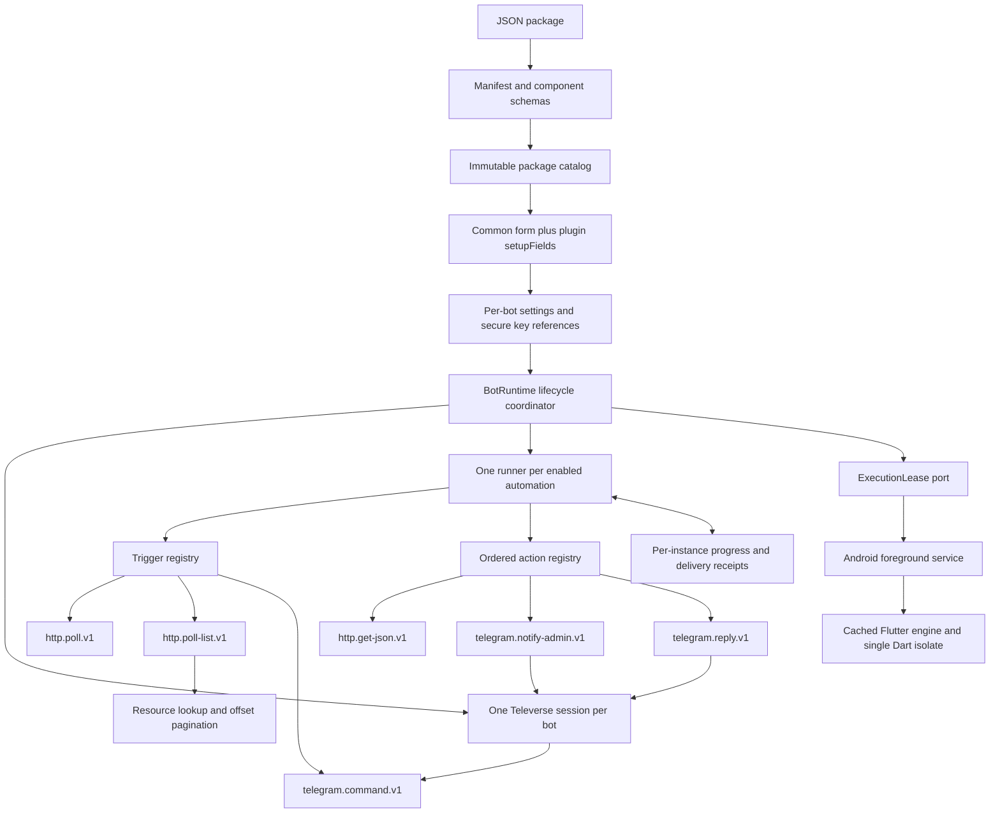

# Plugin runtime

Implemented contract, 2026-11-09. Verification results are recorded after execution below.

## Boundaries



The downloaded JSON declares configuration. It cannot supply Dart/JavaScript/native code, executable class names, or arbitrary message destinations. A new component type needs a host implementation and schema registration in `lib/runtime/registry.dart`. Existing registered types can be composed by JSON alone. The coordinator contains no Inshopa-specific branch. A host presentation registry now supplies direct storefront navigation for exact shipped live packages; it excludes their old catalog command while retaining every other automation and its original progress key. See [Storefront navigation](STOREFRONT_NAVIGATION.md).

`AutomationRunner`, component contracts, request/message execution and schema registration are independent of widgets and Android settings. `BotRuntime` adapts existing bot storage and Telegram lifecycle to the core. The Android platform is accessed through the small `ExecutionLease` port.

## Package versions and installation

Version 1 packages remain setup-only. Version 2 requires `manifestVersion: 2`, `hostApiMajor: 2`, `executionStatus: "live"`, and `automations`. The old `engine` property is forbidden in v2. Unknown component types, unknown configuration keys, unresolved credential references, duplicate IDs/commands, and invalid settings references are rejected on import.

Package definitions stay pinned by ID, version and source digest. Installation shows command availability, request URLs, and polling intervals. Bundled definitions seed once; uninstall remains effective across restart. Existing bots never switch package version or begin executing because a new package was installed.

The common form still asks for name, Telegram bot token and numeric admin ID. The Inshopa plugin adds `apiKey` and the approved `storefrontUrl`. The key selects its one shop; the storefront URL supplies the registration headers. The authenticated `/v1/storefront` lookup provides the shop ID, so no additional shop-ID input is needed.

## Inshopa storefront navigation

As of 2026-11-10, the exact shipped live Inshopa packages use `/start`, `/shop`,
`/orders`, `/help`, and a `/products` compatibility alias to open the existing
HTTPS storefront and `/orders` directly as Telegram Mini Apps. The host does not
fetch products for these commands. Website sign-in and sessions stay in Telegram's
browser and Inshopa; no buyer scope or Inshopa change is required. Existing
package bytes, bot setups and paid-order progress are retained. Custom packages
keep their declared behavior, and setup-only bots remain setup-only. Details and
client verification limits are in [Storefront navigation](STOREFRONT_NAVIGATION.md).

### Original catalog declaration (retained immutable package contract)

[The bundled package](../examples/plugins/inshopa.sales.bottogram-plugin.json) is version 0.5.0, displayed as **Inshopa**. Its public command composes:

```text
/products [page]
  telegram.command.v1
    → http.get-json.v1
        GET https://api.inshopa.ir/v1/storefront/products?limit=10&offset=...
        Authorization: Bearer <secure apiKey>
        Origin: <registered storefront origin>
        X-Storefront-Host: <registered storefront authority>
    → telegram.reply.v1
        reply with product titles to the originating chat
```

This describes the original declaration, which remains in immutable package source. For supported shipped packages its execution is replaced by the host presentation above; modified/custom packages still execute their declared automations. The generic catalog command is public: no admin-ID filter is applied. `/products` requests page 1, `/products 2` requests page 2. Empty pages are explicit. Ten products per page keep the supported 200-character titles inside Telegram's message limit; this is a list, without checkout, buyer login, or product-detail requests. Command queues are bounded. Overloaded command queues ask the requester to retry.

The public API origin is **https://api.inshopa.ir**, verified from `inshopa/gateway/nginx/templates/gateway.conf.template`. The gateway preserves `/v1` and routes that hostname to Go. Independent anonymous checks returned health HTTP 200 and product-list HTTP 401 `CALLER_UNAUTHORIZED`. The SDK constructs `/v1${path}` against `config.apiOrigin`, so the configured origin has no `/v1` suffix. The local web instance separately uses `http://127.0.0.1:8080` as its private upstream.

The Next.js facade also exists at `/api/v1`: a live anonymous request to `https://inshopa.ir/api/v1/storefront/products` returned JSON `SHOP_NOT_FOUND`. Its current implementation obtains credentials from `apiConfig()`, derives context from the ingress Host, and does not forward an incoming customer Bearer key. The external server-side SDK and Bottogram use `api.inshopa.ir` directly. A customer's own browser-facing facade remains on that customer's website. No proxy or backend changes are included here.

An optional [local-development package](../examples/plugins/inshopa.sales.local.bottogram-plugin.json), version 0.5.0 with its own `bottogram-plugin-inshopa-local` ID, uses the verified WSL loopback endpoint. It can be imported for locally issued keys and the Linux preview without conflicting with future production package versions. An Android phone's loopback address points to the phone. HTTP API addresses are allowed only for literal loopback hosts (`localhost`, `127.0.0.1`, `::1`); remote URLs require HTTPS. The registered storefront origin may use HTTP for an existing development registration because it supplies headers, not the credential destination.

Fresh installations seed only the latest 0.5.0 package. Existing definitions and pinned bots remain intact. In particular, 0.2.0 stays setup-only and 0.4.0 stays catalog-only. Installing a new version does not activate alerts on an older bot.

Reachability and SDK publication do not establish production website-key rollout. The Inshopa release records distinguish locally verified key support from production rollout and real client enrollment. Local-key catalog replies and live Telegram delivery are verified below; registered production-key access remains untested.

## Existing cursor-based trigger

The generic HTTP poll trigger is implemented and tested against fixtures. Its request is a bounded GET; response mapping declares `itemsPath`, `itemIdPath`, `checkpointPath`, `hasMorePath`, `nextPagePath` and the cursor query parameter. Poll intervals range from 30 seconds to one day. `initialSync` explicitly chooses `baseline` or `replay`.

For `baseline`, the initial paginated cycle records current event IDs and the checkpoint without notifying about history. Further cycles deliver events. An API may make bootstrap efficient by returning an empty initial snapshot with its current checkpoint. Checkpoint semantics must be agreed with the API, rather than inferred from timestamps.

Every page must use a stable checkpoint for that synchronization cycle. A page cursor resumes pagination; the committed checkpoint advances only after all pages and actions are acknowledged. A bounded recent-ID set also suppresses duplicate events across overlapping pages. Progress is keyed by bot instance, package digest, and automation ID, with action indexes inside each pending event. Successful HTTP action results are retained so a later failed reply does not cause a fresh catalog fetch during recovery.

State lives in `automation_progress_v1`. Existing bot adapters and stored setup maps are not converted, rewritten or backfilled. Stop drains pending acknowledgements; Delete removes that instance's progress and receipt entries. No new database migration is used.

Requests time out after 22 seconds, responses are limited to 1 MiB, each progress record to 2 MiB, and API redirects are refused. Receipt count and total receipt storage grow with observed paid orders. Each bot owns its HTTP client so Stop cancels its requests independently. Retry uses capped backoff and honors numeric `Retry-After`. Authentication/contract failures require attention; credentials and SDK exception URLs are not surfaced in diagnostics.

Telegram delivery is not exactly-once. If the server accepted a message but confirmation or the following durable acknowledgement was lost, a retry can duplicate it. A confirmed action with a durable acknowledgement is not repeated. Outgoing messages use the existing API/inbox transformer path.

## Paid-order polling with the implemented Inshopa contract

Inshopa added the explicitly selected `shop:orders:read` permission to the existing `GET /v1/shops/{shopId}/orders?limit=100&offset=...` summary list. It requires the shop-bound key and registered hostname, without a buyer or seller session. This was verified read-only against `backend/docs/SELLER_API_CLIENTS.md`, the handler and SQL query. The list contains all statuses and is ordered by order creation time. It provides no payment event ID, `paid_at`, API cursor, snapshot boundary, or history/recovery guarantee. Inshopa’s local activation is complete; production was not deployed by this work.

The new generic `http.poll-list.v1` trigger owns HTTP resource lookup, offset pagination and exact-value filtering. The Inshopa JSON declares a lookup to `/v1/storefront`, binds its `id` into the complete `{shopId}` path segment, then filters summaries with `status == paid`. Lookup values cannot populate the scheme, host, query, credentials, or message templates. Both lookup and list requests participate in installer review and required-secret validation. The lifecycle coordinator contains no Inshopa-specific condition.

The first complete scan establishes a client-side baseline of observed paid IDs and sends no historical alerts. Pending orders are not marked as paid; if later observed as paid, they generate an alert even when created long ago. All pages are revisited to avoid a latest-page-only window. A page contains 100 raw summaries; filtering does not change offset advancement or the decision to request the next page. Two seconds separate pages, and a 60-second pause follows a complete scan. The host stops a scan that exceeds the package's 1,000-page limit and reports it explicitly rather than claiming success or silently limiting history.

The runner, not the trigger, records acknowledgements per normalized order ID. List-trigger batches request durable deduplication: one SHA-256-ID receipt is stored per baseline/completed order in the existing progress box, scoped by bot instance, package digest and automation. Receipts survive Stop/Start and disk reopening and are not evicted by the older 2,000-ID recent cache. They consume storage proportional to observed paid orders and are removed with the bot. The original cursor and command components retain their existing bounded recent-cache behavior.

Each action acknowledgement is saved before its delivery receipt. If receipt persistence fails after an acknowledged send, recovery completes the receipt without repeating the action. Local page continuation is saved after processing a page and resumes on restart; it is an offset, not a server-issued cursor or consistent snapshot. Authentication failures stop that automation and show actionable key/permission/registered-storefront guidance. The purchase-notification preference is enabled by default and can be disabled independently of the public products command.

This is best-effort observation of current states. A paid state that appears and disappears between requests may be missed. Concurrent list changes and the API’s creation-time ordering do not provide a stable event-log guarantee, and `created_at` is never treated as a payment timestamp. A payment already confirmed by Telegram but lacking a durable acknowledgement can still be duplicated after an ambiguous failure. No Inshopa source, database, migration, service or production configuration was changed by Bottogram.

## Android execution

An explicitly started bot acquires a foreground execution lease. The native service holds the cached engine and a partial wake lock while bots are started. The Activity can detach and reattach without creating another Dart isolate or Hive writer. An ongoing notification opens the app and exposes Stop bots. The last stopped/deleted bot releases the service and wake lock.

The declared `specialUse` foreground subtype describes the app's continuous user-started Telegram automation purpose. It does not claim to be a file-transfer `dataSync`, media player, alarm, VPN, or companion-device service. Google Play distribution would require the applicable foreground-service declaration/review; local API/emulator success does not establish Play approval. See [Android service types](https://developer.android.com/develop/background-work/services/fgs/service-types#special-use) and [Flutter cached engines](https://docs.flutter.dev/add-to-app/android/add-flutter-screen#step-3-optional-use-a-cached-flutterengine).

No boot receiver or automatic bot restart is installed. Force-stop, process death and reboot require reopening the app and explicitly starting bots again; durable progress is retained. Keeping a wake lock and network polling uses battery. Android/OEM process termination and network outages remain possible.

The guide checks actual battery exemption, background restriction and notification state on every opening and settings return. Unknown state is incomplete. Skipping applies only to this opening; the warning stays fixed outside navigation/scrolling. Settings visits recheck state without an immediate duplicate prompt. Only documented Android settings intents are used.

## Verification

Bot cards now open users/inbox for both manual and plugin bots. Each card has a
separate settings gear. Mobile navigation uses a rounded bar with a centered
creation button, available on both tabs. The plugin configuration summary keeps
its read-only values and opens a separate schema-driven parameter editor from
its Edit button. Blank saved-secret inputs retain their secure values; secrets
are never prefilled. Saving changed parameters stages a fresh setup identity and
secure references before replacing the saved setup, preserving plugin preferences.
The old configuration survives a failed staged write. An active bot is stopped
before saving and restarted afterward; a stopped bot stays stopped. Automation
progress is isolated from the previous connection, so Inshopa establishes a new
baseline without sending paid history after connection changes. A no-op save
preserves the existing identity and progress. No Hive schema migration is needed.
Verification: all 65 unit/widget tests passed and analysis reported no issues.
The card navigation test covers both bot types at 390×844, the centered creation
button, the separate editor and empty secret inputs. Secure-write failure and
credential retention/replacement are covered against the actual repository.
Rendered previews are `build/verification/mobile-bot-navigation.png` and
`plugin-parameter-editor.png`; results are in `card-settings-*-final.log`.
The existing Linux preview hot-reloaded successfully without restarting its bots.

Android API 35 emulator integration passed: the Activity closed, process PID 5669 retained the service and partial wake lock, and the Dart isolate recorded 178 timer ticks in 45 seconds. Independent adb observation confirmed `isForeground=true`, service type `0x40000000`, launcher as the resumed Activity, and forced Doze `mState=IDLE` after battery exemption. Explicit Stop released the service. Temporary idle, battery and exemption settings were restored, then the disposable read-only emulator was stopped. This verifies runtime continuity, not live internet/Telegram delivery under every OEM condition.

Reproduce with `integration_test/background_service_test.dart` and `tool/verify_android_background.py` on the task's disposable read-only emulator. The observer refuses writable/personal-device targets and records `build/verification/android-background-observation.json`. No production debug bridge was added.

Order-polling update verification: all 63 unit/widget tests passed and `flutter analyze --no-pub` reported no issues. The normal Android debug APK rebuilt successfully with 0.5.0 and the timer fix below (`build/verification/local-live-apk-build.log`). New checks cover actual HTTP transport against a local contract fixture, lookup/path/secret validation, baseline and late-paid orders, restart behavior beyond 2,000 IDs, acknowledgement-storage failure, page pacing/Stop, and durable receipts after Hive reopening and per-bot deletion. Stop now cancels the polling/backoff timer itself; a regression test checks that no timer remains after Stop. See `build/verification/sales-*`, `flutter-analyze.log` and `flutter-test.log` for logs. The earlier separate API 35 background integration test passed; native background files were unchanged in this slice. Physical-device OEM behavior remains unverified.

Local live checks on 2026-11-09 used an owner-provided registered key against `127.0.0.1:8080`. The actual Dart HTTP/runtime path resolved the bound shop, returned its one product, and completed an empty-order baseline without historical alerts. `tool/inshopa_local_smoke.dart` repeats these read-only checks with a private connection-file path and emits a counts-only report. It does not send Telegram messages or mutate the shop. Reports are in `build/verification/inshopa-local-live-read.json`.

The opt-in `integration_test/inshopa_local_setup_test.dart` then initialized the normal Linux app, installed local package 0.5.0, added a new test bot without changing existing bots, verified secure API-key readback, completed the persisted initial scan and sent an authorized admin connection-test message. The owner confirmed receipt and a subsequent `/products` response from the normal running app. The report `build/verification/inshopa-local-app-setup.json` contains public identity and result flags only. A newly paid order and its alert remain pending: the local shop currently displays a purchase-unavailable notice, confirmed read-only in the storefront and by the owner. Shop activation belongs to Inshopa and was not changed here. These checks do not establish production-key access or Android delivery.

Linux uses the installed `libsecret`/GNOME Keyring service. A missing WSL session bus initially prevented secure storage; the same test passed in a standard `dbus-run-session` with the existing keyring. `tool/run_inshopa_local_preview.sh` accepts a private credentials-file path and runs the opt-in setup followed by normal `flutter run`. Run it within a desktop D-Bus session (for example `dbus-run-session -- bash tool/run_inshopa_local_preview.sh /absolute/private/telegram.json`). It keeps one native app/Hive owner at a time. Any keyring unlock is handled by GNOME's dialog. No plaintext fallback, empty-password keyring, credential-bearing build define or Inshopa-side change was introduced.

The owner-authorized requirements and planned Telegram connection-card context were sent to the Inshopa integration chat on 2026-11-09. Its later handoff confirmed the owner’s minimal existing-list contract, replacing the dedicated feed proposal. Bottogram now consumes that contract; no Inshopa source, database or production configuration was modified here.
